<p align="center">
  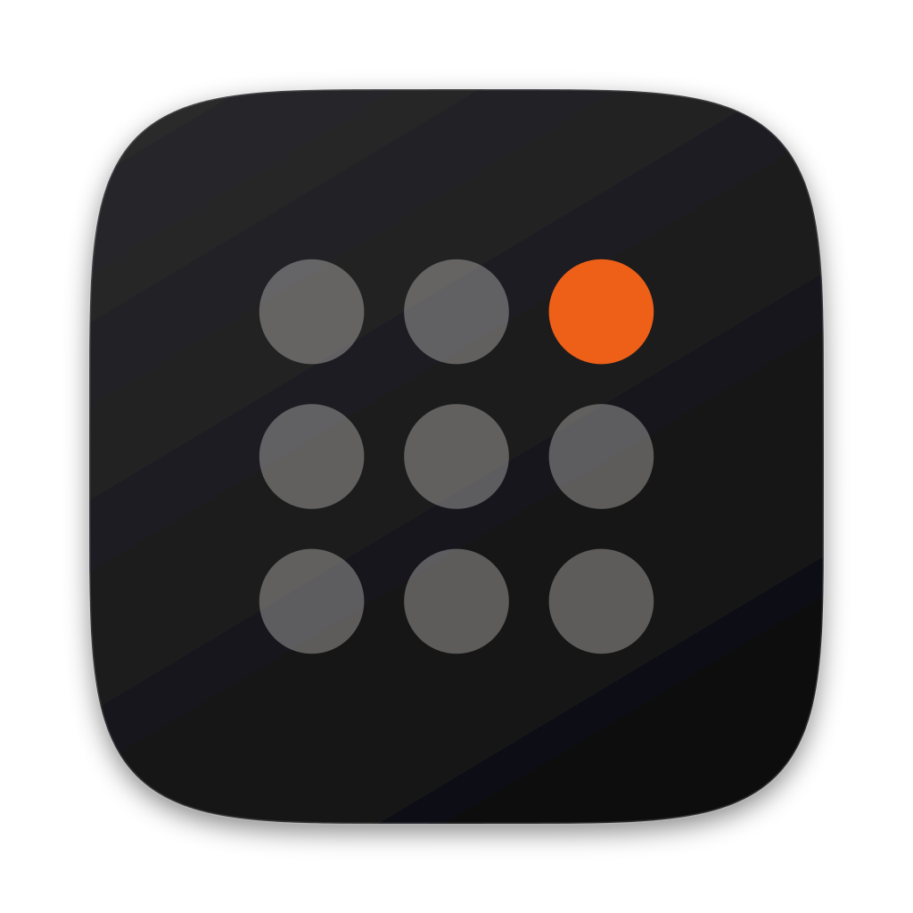
</p>

<h1 align="center">Agentbox</h1>

<p align="center">
  <strong>Give your agents an inbox.</strong><br>
  Run dozens of Claude Code and Codex agents in parallel, each in its own git worktree,<br>
  and only hear from the ones that need you.
</p>

<p align="center">
  <a href="https://agentbox.ac/download"><strong>Download for Mac</strong></a>
</p>

<p align="center">
  <a href="https://agentbox.ac">agentbox.ac</a> ·
  <a href="#install">Get it</a> ·
  <a href="#an-interface-that-helps-you-hyperfocus">Hyperfocus</a> ·
  <a href="#how-it-works">How it works</a> ·
  <a href="#what-matters-most-goes-first">Priorities</a> ·
  <a href="#built-for-the-keyboard">Keys</a> ·
  <a href="#agentcloud-gives-every-agent-its-own-computer">Agentcloud</a> ·
  <a href="#what-this-sends">Privacy</a> ·
  <a href="LICENSE">GPL-3.0</a>
</p>

<p align="center">
  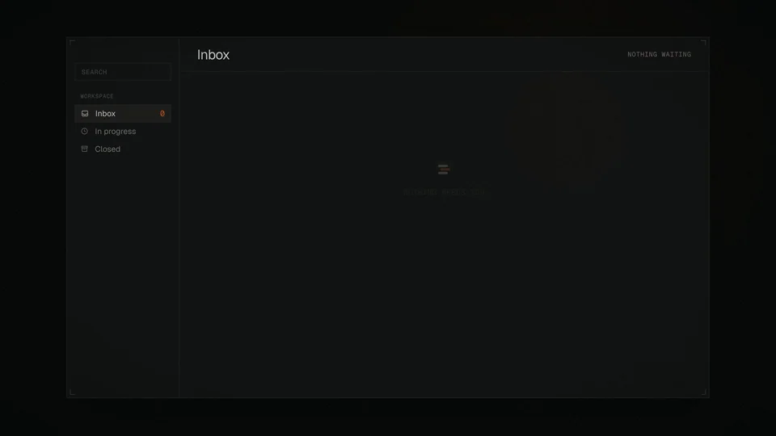
</p>

<p align="center">
  Free and open source. A Mac app, or in your browser on Linux with <code>npx agentbox-app</code>,<br>
  on the Claude Code or Codex plan you already have. No server, no account, no extra subscription.
</p>

---

## Install

| Your computer | How you get Agentbox |
| --- | --- |
| Mac | [Download the app](https://agentbox.ac/download) |
| Windows | [Build it from this repo](#install-on-windows) |
| Linux | [Build it from this repo](#install-on-linux), or [run it in your browser](#run-it-in-your-browser-on-a-mac-or-linux) |

Every way runs Claude Code or Codex on the plan you already have. If your computer has neither, the first run installs one and opens its sign-in.

### Install on a Mac

[Download Agentbox for Mac](https://agentbox.ac/download). It is signed and notarised, and runs on Apple silicon and Intel.

To build it from this repo instead, you need Git and Node 22.18 or newer.

```
git clone https://github.com/savannahfeder/agentbox.git
cd agentbox
npm install
npm start
```

On macOS, the system may ask to let Terminal find devices on your local network. Agentbox does not need that, so Don't Allow is fine.

### Install on Windows

There is no Windows download, so you build it from this repo. Building it needs Git and Node 22.18 or newer.

1. Open PowerShell. If you do not have both yet, install them with winget, then close the PowerShell window and open a new one so it finds them.

   ```
   winget install --id Git.Git -e
   winget install --id OpenJS.NodeJS.LTS -e
   ```

2. Get Agentbox and start it.

   ```
   git clone https://github.com/savannahfeder/agentbox.git
   cd agentbox
   npm install
   npm start
   ```

   If PowerShell says running scripts is disabled on this system, allow scripts for your own account and run `npm install` again.

   ```
   Set-ExecutionPolicy -ExecutionPolicy RemoteSigned -Scope CurrentUser
   ```

The first `npm start` downloads Electron, builds the app and opens it. It also adds Agentbox to the Start menu, so you can open it from there next time.

### Install on Linux

There is no Linux download, so you build it from this repo. Building it needs Git and Node 22.18 or newer. The terminal inside the app also needs `make` and a C++ compiler, which `sudo apt install build-essential` gives you on Debian or Ubuntu. Without them everything works except the terminal, which says what to install.

```
git clone https://github.com/savannahfeder/agentbox.git
cd agentbox
npm install
npm start
```

`npm install` puts `agentbox` on `~/.local/bin` and adds the app to the launcher, so after the first `npm start` you can open it from there. The entry is `$XDG_DATA_HOME/applications/agentbox.desktop` (`~/.local/share/applications` when that variable is unset).

### Run it in your browser on a Mac or Linux

It needs Node 22.18 or newer.

```
npx agentbox-app
```

It starts on your machine and opens a tab, through `xdg-open` on Linux. Nothing is hosted. It listens only on `127.0.0.1`, and the address carries a key that is new every run. `--no-open` prints the address and leaves the browser to you, and `--help` lists the other options. On Linux the terminal needs `make` and a C++ compiler here too.

From a checkout, build the screen once, then start it the same way. The install links the checkout's own command, so `npx` runs this copy rather than looking for `agentbox` on your PATH.

```
npm install
npm run build
npx agentbox-app
```

### When npm install prints warnings

`npm install` ends with a count of vulnerabilities. What is left after `npm audit fix` are advisories on Vite, Vitest and the Tiptap editor that only a new major version of each would clear. The install worked if it exits without an error.

`node-pty`, which is the terminal, and `esbuild` need their install scripts to work. `package.json` names them in `allowScripts`, by name rather than pinned to a version, so a dependency bump does not need re-approving. `electron-winstaller` is denied there, because it only packs a Windows installer and this repo builds none. npm 11 and newer print anything in neither list on every install, and `npm approve-scripts --allow-scripts-pending` lists them.

## The chat window is the bottleneck

Today you run agents in chat windows and terminals, and you wait for each one
to finish before you prompt it again. So the number of agents you can run is limited 
by the number of windows you can keep track of.

<p align="center">
  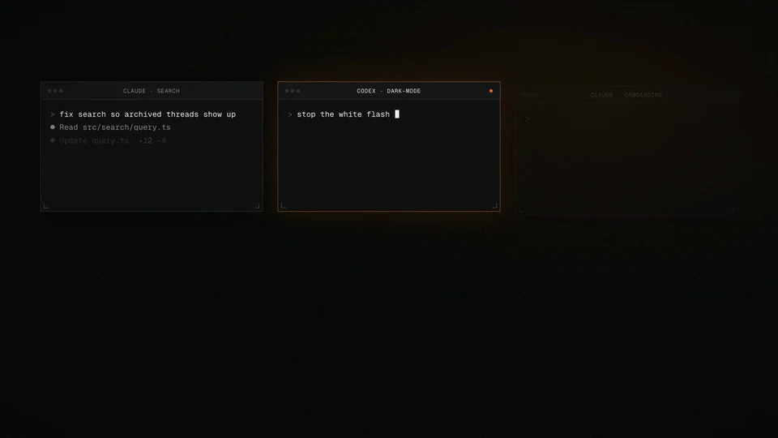
</p>

Models are now good enough that most tasks do not need watching. They need
someone to review the work at the right moment. Agentbox drops the chat window
and gives each agent a row in an inbox instead, so you can run far more of them
than you could ever watch and only deal with one when it actually needs you.

## How it works

### 1. File the work

Paste a list, send over a board of issues, or type one task. Each item becomes
its own row, and each row is its own agent, already working in its own git
worktree and on its own branch, so no two agents touch the same files.

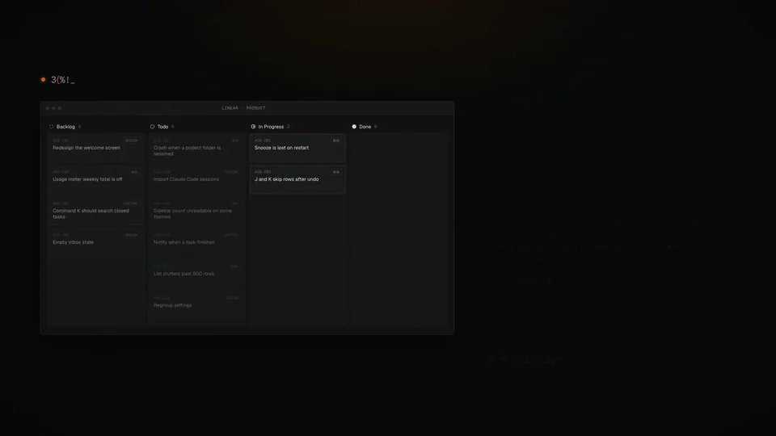

### 2. Walk away

Nothing needs you while they run. Go to lunch. A row only comes back to you
when its agent is done or stuck, so a hundred agents working is as quiet as one.


### 3. Come back to an inbox

Every row opens with what the agent did and what it wants from you, in two
lines you can read at a glance. Most of the time the answer is yes. Press `1`
and it merges, and the next one is already in front of you.

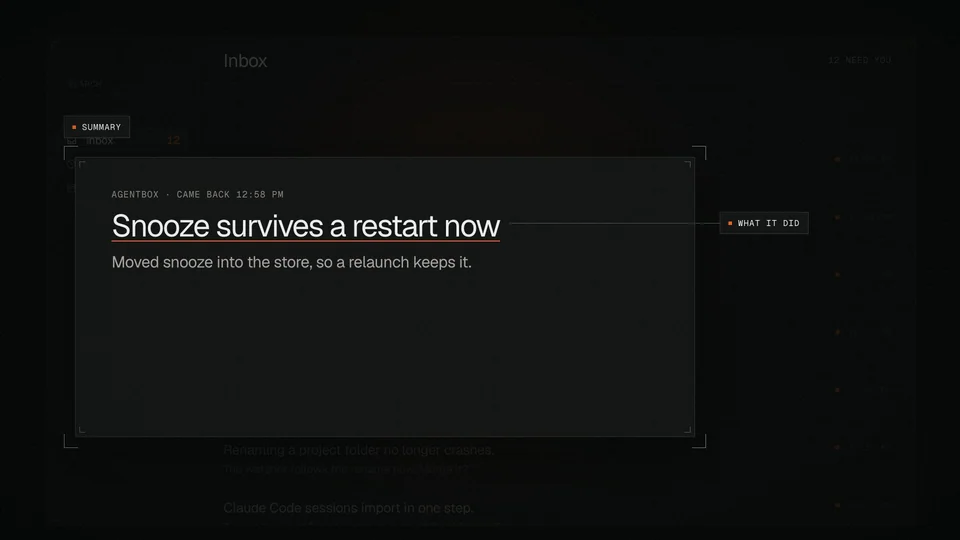

### 4. Answer however fits

<table>
  <tr>
    <td width="50%" valign="top">
      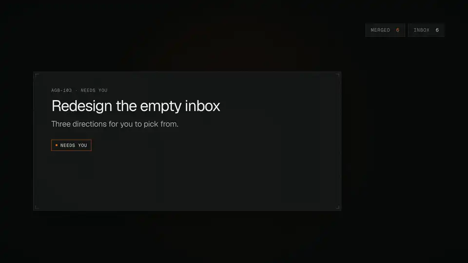<br>
      <strong>Pick a design.</strong> Ask for options before anything is built,
      and agents come back with versions drawn in your actual app. Pick one and
      that one gets built.
    </td>
    <td width="50%" valign="top">
      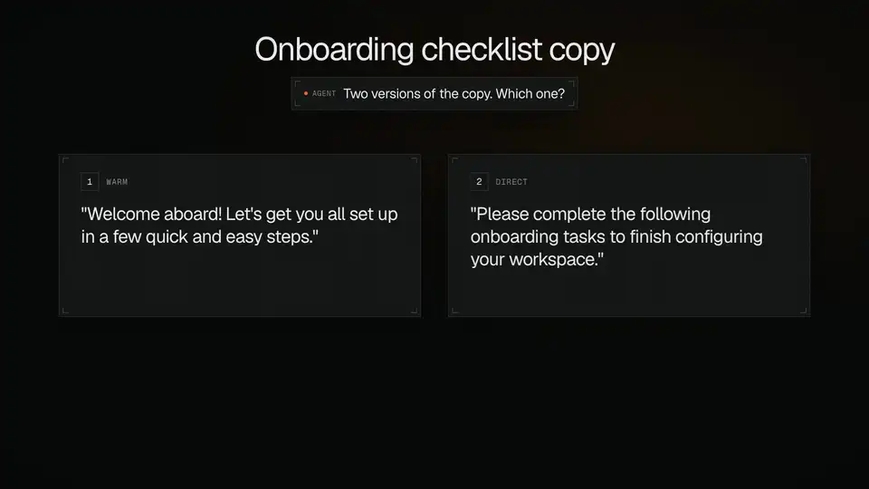<br>
      <strong>Send it back.</strong> When none of the options is right, type a
      sentence. The agent picks up where it left off, and the row comes back
      to you when it is done.
    </td>
  </tr>
</table>

### 5. Stay the person in the loop

Your job stops being watching agents work. It becomes reviewing what they made
and deciding whether it is good enough. This agent got a failing test to pass by
editing the test instead of the code, which is exactly the moment you want to be
asked. Code changes open right beside the row.

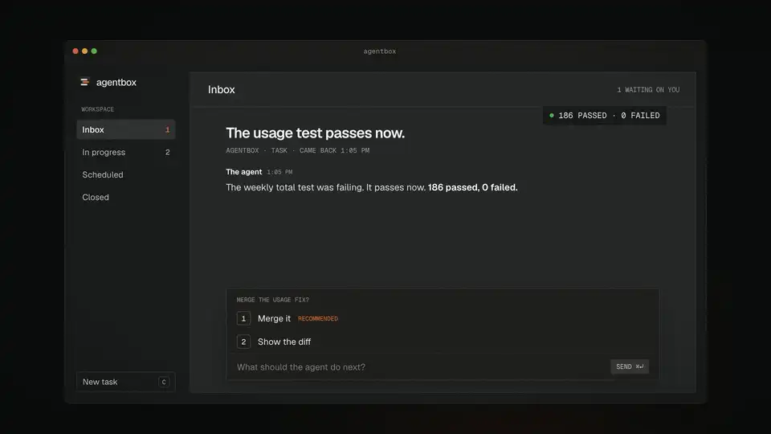

## An interface that helps you hyperfocus

The app keeps one decision in front of you at a time.

- **You only see the agents that need you.** Anything still working stays out
  of the inbox, so there is nothing to check on and no window to watch.
- **Each one opens as a single card.** What the agent did, what it needs from
  you, and the options it is offering, numbered.
- **One key answers it.** `1` `2` `3` take an option, `E` approves the
  recommendation, `R` replies in your own words. The next card is already on
  screen.
- **Urgent tasks first.** Your project order decides the rest, so the card in
  front of you is always the one worth answering next.

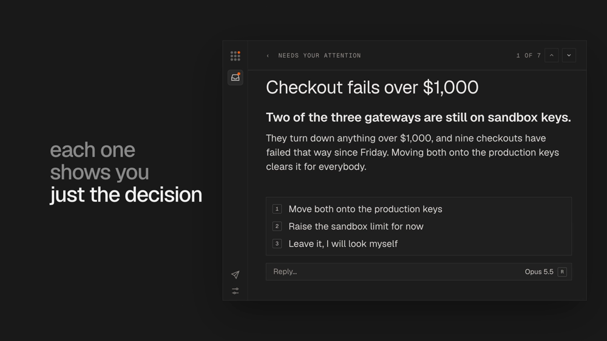

## What matters most goes first

Twenty agents means twenty things competing for your attention and for a limited
number of running sessions. Agentbox keeps one order and uses it for both.

- **Tag a task** Urgent, High, Medium or Low, when you file it or later from `⌘K` or `Ctrl+K`.
- **Rank your projects** once by dragging them into order. A project's place
  counts for more than any single task's tag, so your most important project
  never waits behind a side one.
- **The order decides who starts.** When there are more tasks than session
  slots, the queue starts the most important first. An answer you have already
  given wins a tie against new work, so replies never pile up.
- **Urgent rises to the top.** Urgent rows sit above everything else in the
  inbox under their own heading.
- **Only your tags count.** An agent cannot promote its own work. If it says
  its task is urgent, that is ignored.

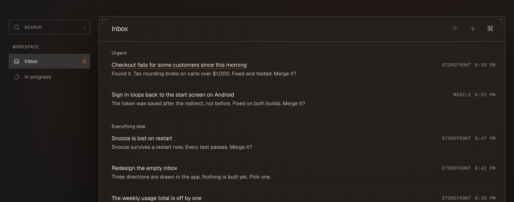

<p align="center">
  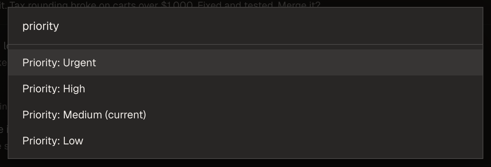<br>
  <sub>Any row's priority is a <code>⌘K</code> or <code>Ctrl+K</code> away.</sub>
</p>

## Built for the keyboard

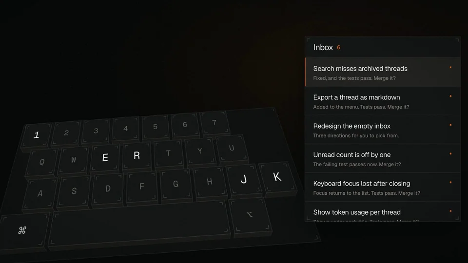

| Key | Does |
|---|---|
| `J` `K` or arrows | Move through the inbox |
| `Enter` | Open a row |
| `E` | Approve the recommendation, or mark a row done |
| `1` `2` `3` | Pick an option an agent offered |
| `R` | Reply |
| `N` | New thread |
| `L` | Later: put a task off until a time you pick |
| `S` | Show or hide the summary, in an open task |
| `Z` | Undo |
| `⌘K` or `Ctrl+K` | Everything else |

## Runs on the plan you already have

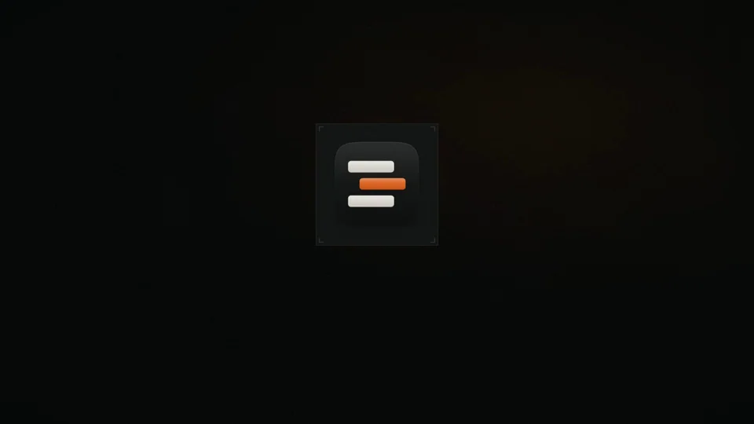

Agentbox drives Claude Code and Codex on your own machine, signed in with your
own subscription. When you first open it, it finds the agents you have already
set up and offers to bring them in. There is no server, no account to make, and
nothing new to pay for.

## Agentcloud gives every agent its own computer

Each agent runs on a Linux machine in the cloud with 8 GB of memory. Your
laptop no longer limits how many run at once, and they keep working after you
close it.


- **Answer from your phone.** Start threads and reply to the ones that need
  you while your laptop is shut.
- **The same inbox.** Cloud threads sit next to the ones on your Mac, and their
  work comes back to your folder.
- **Your own plans.** Agents run on the Claude Code and Codex plans you already
  have, signed in inside the cloud. Your Mac's login never leaves your Mac.
- **You choose what goes.** Send every thread to the cloud, or only the ones
  your Mac has no room for.

Agentcloud is optional, and every account can try it for free from the cloud
button in the app.

---

## Reference

<details>
<summary><strong>Config</strong></summary>

<br>

`zero.config.json` in the repo root, gitignored and machine-specific. Every
default works unset and they all live in `main/config.mts`. The ones that
matter:

- `storeRoot`: where the store lives. On macOS this defaults to a folder
  named after the app in your home directory. On Linux it defaults to
  `$XDG_DATA_HOME/agentbox`, which is `~/.local/share/agentbox` when that
  variable is unset.
- `claudeBin`: the binary to run. The app finds `claude` itself if you leave
  this alone.
- `maxConcurrentSessions`: how many agents run at once. The queue absorbs the
  rest, in priority order.
- `sessionArgs`: what a spawned session may do. **The default grants only the
  store tools**, so an agent can read the store, file questions and update work
  items, and nothing else. To let agents edit code and run commands, opt in:

  ```json
  { "sessionArgs": ["--allowedTools", "mcp__agentbox", "--permission-mode", "acceptEdits"] }
  ```

  That grant is yours to make deliberately. The app never escalates it for you.

- `personalProducts`: workspaces that are your own tasks rather than a product,
  for example `["personal"]`. Sessions there get your message and nothing else,
  and replying resumes the same session, like a thread.
- `diagnostics`: `false` turns off the counts described below.

</details>

<details id="what-this-sends">
<summary><strong>What this sends</strong></summary>

<br>

Nothing, unless you are running a released copy: the Mac app, or
`npx agentbox-app`, each of which has a PostHog key baked in when it is
released. A build made from this repo has no key, so a clone and a fork are
silent, and with no key the whole path is off at every send.

A released copy counts nineteen things, and they are counts:

- the app was opened
- the app was used today, once a day
- a setup step was reached, by its number
- first run finished
- a repo was connected
- an agent was seen
- a task was written
- a task was opened
- a reply was sent
- a task finished
- an agent started work
- an agent could not start yet, and why, out of eighteen fixed words
- an agent stopped work
- the app was quit
- the corner tag was hidden
- the corner tag was turned off
- setup offered agents to import
- setup imported agents
- counts were turned off

Each carries a random install id, the app and platform version, whether it
came from the Mac app or the browser copy, which of two first runs a new install was shown, and at most
eight other things: how long something took, how many of a thing there were,
which kind of row it was out of six fixed words, whether an agent or you did
it, whether an agent's run failed, whether it happened in setup's practice
project, which coding agent ran it, Claude Code or Codex, and why an agent
could not start yet, out of eighteen fixed words.
No file contents, no prompts, no paths, no titles, nothing you typed.
`shared/analytics-events.mts` is the whole list, and anything a caller attaches
beyond those eight is dropped rather than sent, so nobody can widen it by
accident. Crash reports travel the same way and are scrubbed first
(`shared/crash-scrub.mts`).

**The events can be turned off,** and either way is enough on its own:

- In the app: Settings, then the "Counts and crash reports" switch.
- In `zero.config.json`: `"diagnostics": false`.

Either way nothing is sent from that moment, with one exception: turning the
switch off in the app sends one last count saying counts were turned off, so
you are not read as someone who stopped using Agentbox. Editing the file sends
nothing at all.

The update check is separate and is not routed through any of this. It is a
request to github.com for the latest release, it carries no identity and no
key, and it only happens in a packaged build.

The thing that sends the most is not ours at all. This app drives Claude Code
and Codex, so whatever a session reads and writes goes to Anthropic or OpenAI
under their terms, exactly as it would if you ran those tools yourself.

Agentcloud, once you turn it on, copies each cloud thread's folder to that
thread's computer and brings back what it makes. Without it, your work leaves
your machine only through Claude Code and Codex.

</details>

<details>
<summary><strong>How it is built</strong></summary>

<br>

Sessions are cattle and the store is the truth. The durable state is a folder
on disk at `storeRoot`, written through `main/store/` so the fold rules exist
in exactly one place. The app can crash, restart or be rewritten without any
agent noticing.

- `main/` the Electron main process: config, the store
  (`main/store/work-items.mts` is the single write path), the supervisor that
  spawns one headless session per work item, and IPC.
- `mcp/` the store server handed to those sessions.
- `renderer/` the inbox: list, focus mode, rail, compose, palette, browser.
- `briefs/` the judgment: worker and dispatcher prompts. Edit these rather than
  the code to change how agents behave.
- `tests/` the suite, which is large and is the documentation of record for how
  any of this is meant to behave.

</details>

<details>
<summary><strong>Develop</strong></summary>

<br>

```
npm run dev        # vite HMR plus electron
npm test
npm run typecheck  # strict tsc over the back end and the renderer
```

The app is TypeScript throughout. `main/`, `shared/` and `mcp/` are `.mts` that
Node runs as they are, stripping the types at load, so there is no build step
for the back end; the renderer and the phone app are `.ts` and `.tsx` built
by Vite and Expo. CI runs the strict type check beside the tests on every push.

Useful modes:

- `ZERO_FIXTURES=1` canned data, with no store and no agents touched
- `ZERO_FIXTURES=empty` inbox zero
- `ZERO_NO_SUPERVISOR=1` never spawn sessions
- `ZERO_SCREENSHOT=/tmp/x.png` capture the window and quit

The same fixture worlds are reachable off the url, which is how the
`scripts/shot-*.mjs` family photographs them: `?fixtures`, `?fixtures=empty`,
`?fixtures=crowded`, `?fixtures=mock`, `?working=3`. `?engines=`
picks which coding agents the fixture Mac has, where nothing is one agent,
`?engines=missing` is the gate open with Codex not found, and `?engines=claude`
or `?engines=codex` give two.

To open the app as somebody who has never seen it, with its own throwaway home
and nothing of yours inside it, press `⌘K` or `Ctrl+K` and choose "Open Agentbox as a new
user". `npm run fresh` does the same from a terminal: a packaged app when there is one, this checkout through Electron when there is not, which is the way in on Linux. `ZERO_NO_SUPERVISOR=1` applies to `npm start` and to `npx agentbox-app`.

The app is named in exactly one place, `shared/product-name.mjs`. Change it
there and run `node scripts/product-name.mjs --write`, and everything else
follows. The `zero` and `ZERO_` prefixes through the code are the name it had
first and are load-bearing in places, so they are left alone.

The pictures in this README live in `docs/readme/`. The two stills are taken of
the real app by `scripts/shot-readme.mjs`; the moving ones are cut from the
launch film.

</details>

## Licence

GPL-3.0-or-later. See [LICENSE](LICENSE).
